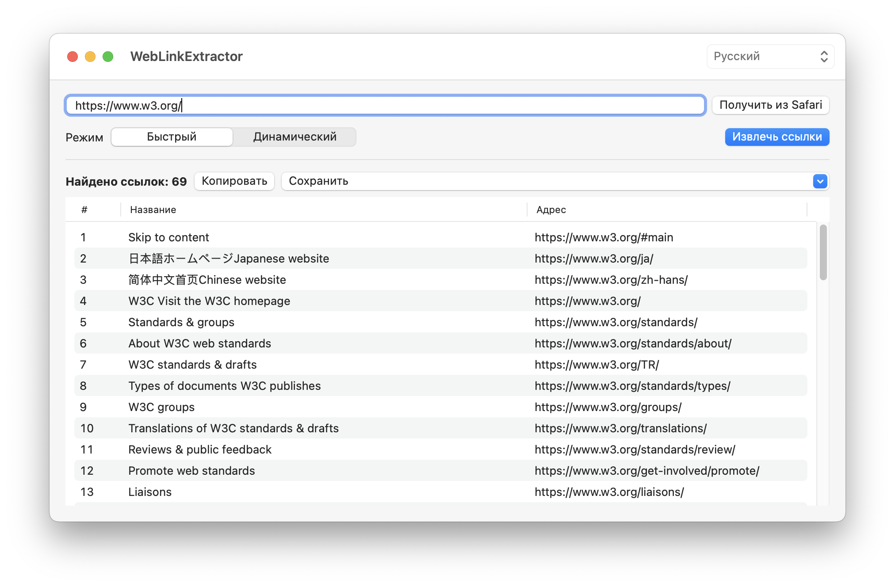

# WebLinkExtractor

**Free macOS Link Extractor | Бесплатная программа для извлечения ссылок**

A free, bilingual macOS application for extracting links from web pages.

Бесплатное приложение для macOS, позволяющее извлекать ссылки с веб-страниц и сохранять результаты в удобных форматах.

**[⬇ Download WebLinkExtractor 1.0 / Скачать программу](https://github.com/silkirgiz/WebLinkExtractor/releases/latest)**

---

## 🇷🇺 Русский

### Возможности

- Получение адреса текущей страницы из Safari.
- Ручной ввод URL любого доступного сайта.
- Два режима извлечения ссылок:
  - **Быстрый** — анализ HTML-кода.
  - **Динамический** — обработка страницы с выполнением JavaScript.
- Извлечение названий и адресов ссылок.
- Удаление повторяющихся ссылок.
- Просмотр результатов с нумерацией.
- Копирование результатов в буфер обмена.
- Сохранение в **TXT, CSV и HTML**.
- Переключение русского и английского языков.

### Системные требования

- macOS Ventura 13.0 или новее.
- Компьютер Mac с процессором Intel или Apple Silicon.
- Подключение к интернету для обработки веб-страниц.

### Установка

1. [Скачайте последнюю версию](https://github.com/silkirgiz/WebLinkExtractor/releases/latest).
2. Распакуйте ZIP-архив.
3. Переместите WebLinkExtractor.app в папку «Программы».
4. Запустите приложение.

**Важно:** приложение не нотариализовано Apple. При блокировке запуска воспользуйтесь разделом «Системные настройки → Конфиденциальность и безопасность → Всё равно открыть».

Быстрый режим не выполняет JavaScript. Динамический режим использует отдельную браузерную сессию, поэтому авторизация Safari автоматически не переносится.

---

## 🇬🇧 English

### Features

- Get the current page URL from Safari.
- Enter a URL manually.
- Two extraction modes:
  - **Fast** — analyzes static HTML.
  - **Dynamic** — processes JavaScript-generated content.
- Extract link titles and URLs.
- Remove duplicate links.
- View numbered results.
- Copy results to the clipboard.
- Export to **TXT, CSV, and HTML**.
- Switch between Russian and English.

### System Requirements

- macOS Ventura 13.0 or later.
- Intel or Apple Silicon Mac.
- Internet connection for processing web pages.

### Installation

1. [Download the latest release](https://github.com/silkirgiz/WebLinkExtractor/releases/latest).
2. Extract the ZIP archive.
3. Move WebLinkExtractor.app to the Applications folder.
4. Launch the application.

**Important:** This application is not notarized by Apple. If macOS blocks it, use System Settings → Privacy & Security → Open Anyway.

Fast mode does not execute JavaScript. Dynamic mode uses a separate browser session and does not automatically share Safari authentication.

---

## Download / Скачать

**[WebLinkExtractor — Latest Release](https://github.com/silkirgiz/WebLinkExtractor/releases/latest)**

Free to download and use. / Бесплатное скачивание и использование.

Version 1.0 — macOS Universal (Intel & Apple Silicon).
